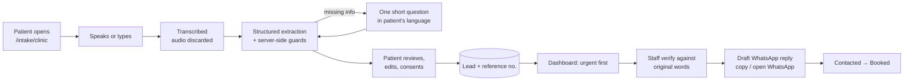
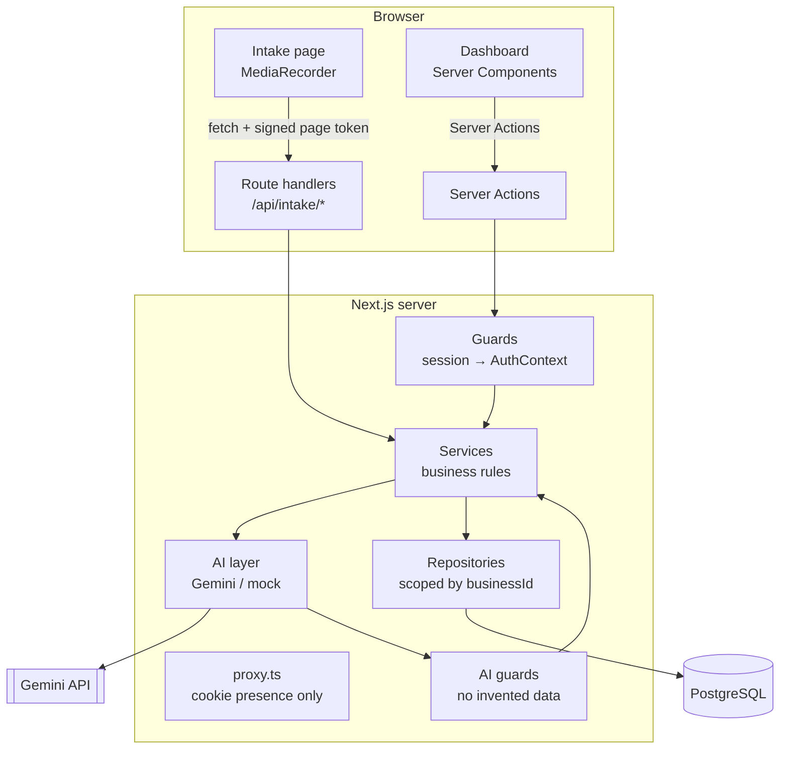
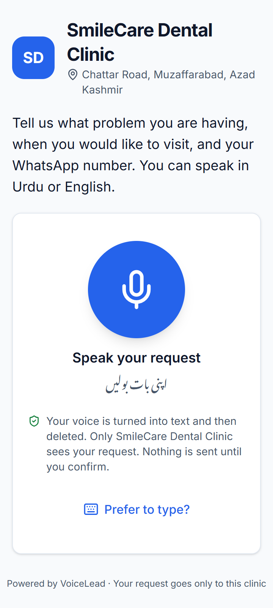
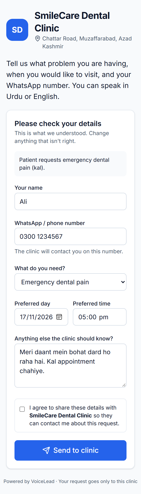
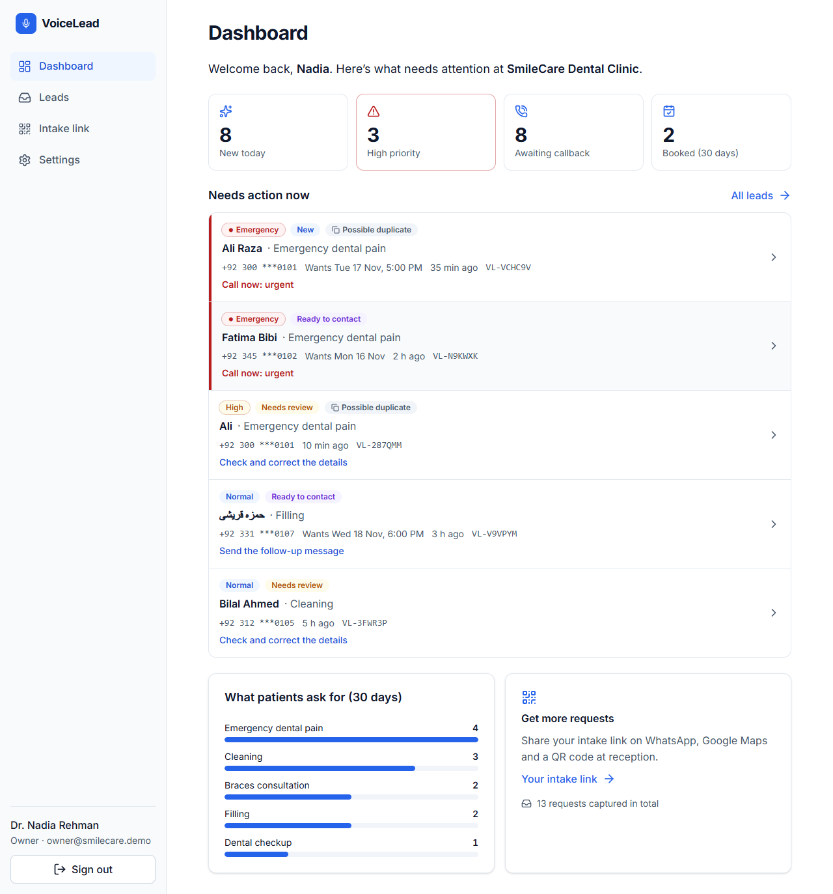
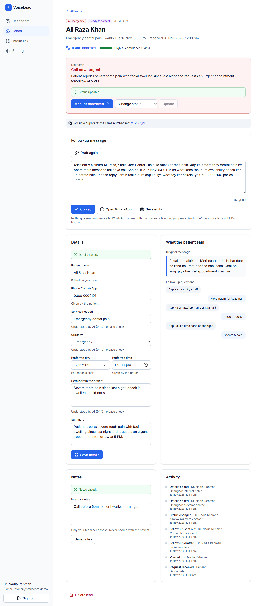

# VoiceLead

**VoiceLead turns after-hours customer voice messages into qualified, actionable leads for local service businesses.**

MVP niche: **dental clinics in Pakistan.** A patient opens the clinic's link, speaks naturally in Urdu, English or Roman Urdu, answers at most a few short follow-up questions, checks the details and sends. The clinic sees a clean, prioritised lead with the original words beside every extracted field, and copies a ready-made WhatsApp reply.

AI assists; people decide. VoiceLead never contacts a patient, books an appointment or sends a message on its own.

---

## The problem

Small clinics lose patients when calls go unanswered, reception is busy or the clinic is closed. Requests arrive as voice notes and missed calls. Staff then listen, call back, ask the same questions again and type details by hand. Urgent cases wait in the same queue as routine cleanings.

## Who it's for

| User                                            | Needs                                                                                                            |
| ----------------------------------------------- | ---------------------------------------------------------------------------------------------------------------- |
| **Patient** (often on a phone, Urdu or English) | Ask for help in under a minute, by voice, without an account or a long form, and know the request arrived.       |
| **Clinic owner / receptionist**                 | See every request, know which are urgent, correct anything the AI got wrong, follow up quickly, stay in control. |

## How it works



## Features

**Patient intake (public, no account)**

- One large microphone button, 3-minute limit, visible timer; or type instead.
- Editable transcript before anything is analysed.
- At most one clarifying question at a time, in Urdu script, Roman Urdu or English; answer by voice or text; optional questions can be skipped; the browser's free voice can read questions aloud.
- Review screen where every detail is editable, explicit consent, reference number on success.
- Emergency guidance with a one-tap call button when the request sounds urgent.
- Delete your own request within 24 hours (button on the success screen, or a private link).
- Friendly states for microphone denied, recording too short, no speech, network failure, AI unavailable (falls back to a short form), invalid link, paused clinic, expired page.

**Clinic dashboard**

- At a glance: new today, high priority, awaiting callback, booked; "needs action now" list; what patients ask for.
- Lead list: filters, search by name / phone (any format) / reference / service, most-urgent-first or newest-first, masked phone numbers, possible-duplicate badges.
- Lead detail: next-step guidance, status workflow, every AI field editable with its source ("Understood by AI 85%", "Given by the patient", "Edited by your team"), the original transcript and Q&A side by side, AI confidence, automatic-check warnings.
- Follow-up message: drafted by AI in the patient's language and the clinic's tone (template fallback), editable, one-click copy, "Open WhatsApp" with the text pre-filled. Staff press Send.
- Internal notes, full activity history, owner-only deletion that erases personal data.
- Onboarding in three steps with dental defaults, settings, intake link with QR code.

## Tech stack

Next.js 16 (App Router, Cache Components) · React 19 · TypeScript (strict, no `any`) · Tailwind CSS v4 · Prisma 7 + PostgreSQL (embedded PGlite locally, hosted in production) · Zod 4 · Vercel AI SDK 7 + Google Gemini · argon2id · Vitest · Playwright (end-to-end, run locally against Edge)

## Architecture



```
src/
  app/                 routes: (marketing), (auth), onboarding, dashboard, intake/[slug], api/intake/[slug]/*
  components/          ui (design system), forms, dashboard, leads, voice (intake), intake-link
  lib/                 pure, shared code: constants (allowlists), Zod schemas, phone, dates, follow-up templates
  server/
    auth/              sessions, guards, authorize(), permissions
    ai/                provider interface, Gemini + mock, prompts, output guards
    services/          business rules (intake, leads, onboarding, settings)
    repositories/      all database access, always scoped by the session's clinic
prisma/                schema, migrations, demo seed
tests/                 unit + integration (throwaway in-memory Postgres)
scripts/local-db.mjs   embedded Postgres for local development
```

## Security model

| Concern                     | How it's handled                                                                                                                                                                                                                                                                                                                                                                                                                                    |
| --------------------------- | --------------------------------------------------------------------------------------------------------------------------------------------------------------------------------------------------------------------------------------------------------------------------------------------------------------------------------------------------------------------------------------------------------------------------------------------------- |
| **Authentication**          | Email + password (argon2id, OWASP parameters, common-password blocklist). 256-bit random session token in a `__Host-` HttpOnly, Secure, SameSite=Lax cookie; only an HMAC of it is stored. 7-day sliding / 30-day absolute expiry; rotated on sign-in; deleted on sign-out. Equal-time responses for unknown emails.                                                                                                                                |
| **Authorization**           | Every protected page and Server Action re-reads the session on the server. A single permission matrix (owner / staff). `authorize()` throws, so a forgotten check can't silently allow access.                                                                                                                                                                                                                                                      |
| **Tenant isolation / IDOR** | Repositories take an `AuthContext` built only from the session and add `businessId` to every query. Another clinic's lead id is indistinguishable from a missing one. Tested by replaying real Server Action requests with another clinic's cookie.                                                                                                                                                                                                 |
| **CSRF**                    | Server Actions: framework Origin check (POST only). Route handlers: explicit same-origin check. SameSite cookies.                                                                                                                                                                                                                                                                                                                                   |
| **Input validation**        | Zod on every input (forms, JSON, query strings, uploaded audio type/size, JSON DB columns, AI output). Allowlists for status, urgency, role, language, tone. Pakistani phone normalisation (incl. Urdu digits).                                                                                                                                                                                                                                     |
| **AI output**               | Validated by schema, then server guards: names and phone numbers must literally appear in what the patient said; dates limited to today–6 months; red-flag symptoms raise urgency to at least "high"; follow-ups that claim an unbooked appointment are rejected. The AI result is HMAC-signed and bound to the exact conversation, so a patient can edit their details but cannot forge urgency or confidence. Prompts treat patient text as data. |
| **Public endpoints**        | Signed short-lived page token per clinic, per-IP rate limits, per-clinic daily cap, request-size limits, audio type allowlist.                                                                                                                                                                                                                                                                                                                      |
| **Abuse limits**            | Sign-in (per email + IP), sign-up (per IP), intake transcribe / analyse / submit / delete, dashboard mutations and AI drafts (per user).                                                                                                                                                                                                                                                                                                            |
| **Errors & logs**           | Users only see friendly messages; error boundaries never render error details. Logs contain operation names and error types only, never prompts, transcripts, phone numbers or keys.                                                                                                                                                                                                                                                                |
| **Headers**                 | CSP, HSTS, X-Frame-Options DENY, nosniff, strict referrer policy, Permissions-Policy (microphone for our own origin only).                                                                                                                                                                                                                                                                                                                          |
| **Shared computers**        | Sign-in and sign-out do a full page load so Next.js's preserved (hidden) pages from a previous user are discarded.                                                                                                                                                                                                                                                                                                                                  |

## Privacy model

- Recording consent notice before the microphone is used; explicit consent before sending.
- **Audio is never stored.** It is held in memory only for transcription; only the text is kept.
- Phone numbers are masked in lists; the full number appears only on the lead page.
- Audit log of created / viewed / edited / status changed / follow-up drafted and sent out / deleted. Audit entries record _which_ fields changed, never their values; IPs are stored as HMACs.
- Patients can delete their request within 24 hours using a secret shown once (stored only as a hash; the private link keeps it in the URL fragment, which browsers never send to servers).
- Deletion erases personal data and the conversation; only a reference-number stub remains for the audit trail.

## Local setup

Requires **Node.js 20.19+**.

```bash
npm install                 # also generates the Prisma client
cp .env.example .env        # fill in the two secrets (command in the file)
npm run db:seed             # create + seed the local database
npm run dev                 # http://localhost:3000
```

No PostgreSQL install needed: `npm run dev` starts an embedded Postgres ([PGlite](https://pglite.dev), real Postgres compiled to WebAssembly) on port 5433, applies migrations, then starts Next.js. Data lives in `.pglite/`.

With npm 11 you may need to approve install scripts once: `npm install-scripts approve @prisma/engines prisma esbuild`.

| Script              | What it does                                                   |
| ------------------- | -------------------------------------------------------------- |
| `npm run dev`       | local Postgres + Next.js dev server                            |
| `npm run check`     | typecheck + lint + all tests                                   |
| `npm run test`      | unit + integration tests on a throwaway in-memory Postgres     |
| `npm run build`     | production build (Vercel runs `vercel-build`: migrate + build) |
| `npm run db:seed`   | (re)seed the local demo data                                   |
| `npm run db:reset`  | wipe the local database and reseed                             |
| `npm run db:studio` | browse the local database                                      |

## Environment variables

| Variable              | Required        | Purpose                                                                                                       |
| --------------------- | --------------- | ------------------------------------------------------------------------------------------------------------- |
| `DATABASE_URL`        | yes             | PostgreSQL URL. Locally set automatically by `npm run dev`                                                    |
| `DATABASE_POOL_MAX`   | no              | Connections per server instance (default 5; keep small on serverless)                                         |
| `APP_URL`             | yes             | Public base URL, used for intake links and QR codes                                                           |
| `SESSION_SECRET`      | yes (32+ chars) | Session token HMAC and signed tokens                                                                          |
| `IP_HASH_SECRET`      | yes (32+ chars) | HMAC for IPs and rate-limit keys                                                                              |
| `GEMINI_API_KEY`      | for AI          | Free key from Google AI Studio. Without it, intake falls back to the short form and follow-ups use templates. |
| `GEMINI_MODEL`        | no              | Defaults to `gemini-flash-lite-latest`                                                                                |
| `AI_PROVIDER`         | no              | `gemini` (default) or `mock` (rule-based, for automated tests only)                                           |
| `DEMO_OWNER_PASSWORD` | for seeding     | Password for the demo accounts                                                                                |
| `SHOW_DEMO_LOGIN`     | no              | `true` shows the demo accounts on the sign-in page                                                            |

The server validates these at startup and serves nothing if a required one is missing.

## Demo

| Account                  | Role                                               |
| ------------------------ | -------------------------------------------------- |
| `owner@smilecare.demo`   | Owner of SmileCare Dental Clinic                   |
| `staff@smilecare.demo`   | Receptionist (staff: no settings, no delete)       |
| `owner@brightsmile.demo` | Owner of a second clinic (proves tenant isolation) |

Password: the value of `DEMO_OWNER_PASSWORD`. Patient page: `/intake/smilecare-dental`.

**Demo data:** a fictional SmileCare Dental Clinic in Muzaffarabad, Azad Kashmir (Mon–Sat, 10 AM–8 PM) with 13 leads: 3 emergencies (Roman Urdu, Urdu script, English), 3 cleanings, 2 fillings, 2 braces consultations, a root canal, an incomplete lead and a duplicate-looking lead from the same number. Leads cover every status and include conversations, field provenance and audit history. All people and numbers are invented (subscriber numbers like `0300 0000101`).

## Testing

- **Unit:** phone parsing, validation, permissions, session expiry, slugs, safe redirects, AI guards, question flow, signed tokens, follow-up templates, workflow rules.
- **Integration (real Postgres, in memory):** tenant isolation, role checks, IDOR on every lead operation, onboarding replay protection, the full intake conversation from the spec, tampering with signed AI results, customer deletion, privacy-preserving delete, audit contents.
- **End-to-end (Playwright driving Edge, mock AI, fake microphone):** sign-in/out, cookie flags, open redirects, rate limiting, onboarding, voice intake to saved lead, microphone denied, invalid/paused links, dashboard workflow, follow-up copy/WhatsApp, IDOR via URL and via replayed Server Actions, CSRF, 360 px layouts. These scripts are run locally and are not yet part of the repository.

## Known limitations

- **Gemini audio formats:** Chrome/Edge record `audio/webm` (Opus), which isn't on Gemini's documented format list. It generally works but should be verified with a real key; Safari's `audio/mp4` is supported.
- **Live AI not verified in this build:** automated tests use the deterministic mock; prompt quality needs tuning with real Urdu recordings.
- **CSP allows inline scripts.** Per-request nonces would make every page dynamic and disable Next.js's static shells; the other directives are strict and the app renders no raw HTML.
- **Changing a clinic's link name** breaks previously shared links, including patients' 24-hour deletion links.
- **Sign-up reveals whether an email is registered** and there is no email verification yet (rate-limited; a known MVP trade-off).
- **Rate limiting uses the database** (fine for MVP traffic; swap for Redis/Upstash at scale).
- **Urgency sorting is done in memory** for up to 1,000 matching leads per clinic.
- **Staff accounts are seeded only;** there is no invite flow yet.
- Relative dates ("kal") are resolved by the AI against Pakistan time; staff should confirm.

## Deployment (Vercel + Neon Postgres)

Live demo: **https://voicelead.vercel.app** (demo logins are shown on the sign-in page).

1. Import the GitHub repo in Vercel.
2. Project → **Storage** → create a **Neon** database and connect it to the project. This sets `DATABASE_URL` (pooled, used by the app) and `DATABASE_URL_UNPOOLED` (direct, used for migrations).
3. Set the remaining variables: `APP_URL` (your Vercel domain), fresh 32+ character `SESSION_SECRET` and `IP_HASH_SECRET`, `GEMINI_API_KEY`, `DATABASE_POOL_MAX=3`, and for a public demo `SHOW_DEMO_LOGIN=true`, `DEMO_OWNER_PASSWORD`, `SEED_DEMO_DATA=true`.
4. Push to `main`. Vercel runs `vercel-build`: `prisma migrate deploy`, then `scripts/seed-if-empty.mjs` (loads demo clinics only when `SEED_DEMO_DATA=true` **and** the database has no businesses, so it never touches real data), then `next build`.

## Future roadmap (not in V1)

- WhatsApp Business Cloud API integration (send and receive from the dashboard)
- Real phone-call voice agent for missed calls
- Google Calendar availability and booking
- SMS automation
- Multi-business SaaS onboarding, staff invites and billing
- Advanced analytics (conversion, response times)
- Premium voices and voice cloning

## Screenshots

| Patient: speak                                 | Patient: review                               | Clinic: dashboard                            | Clinic: lead                              |
| ---------------------------------------------- | --------------------------------------------- | -------------------------------------------- | ----------------------------------------- |
|  |  |  |  |
